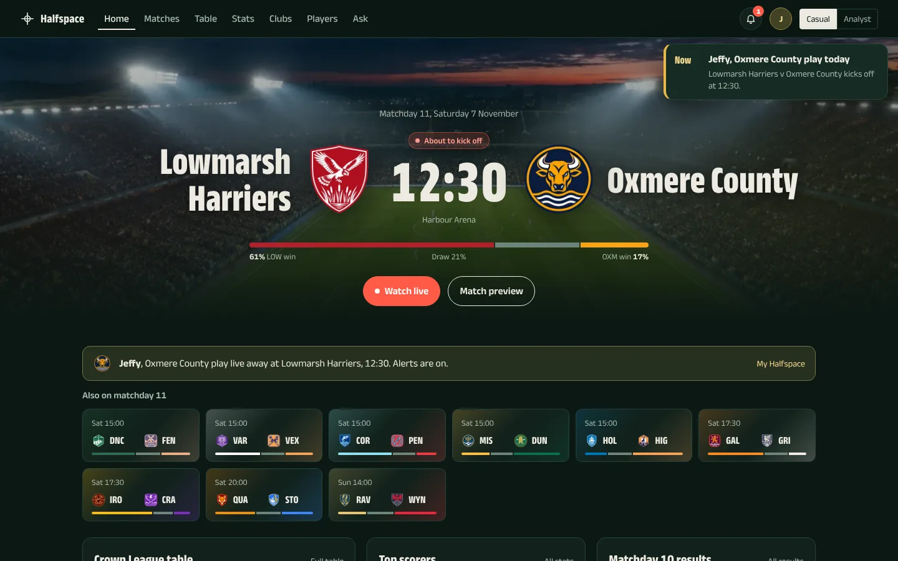
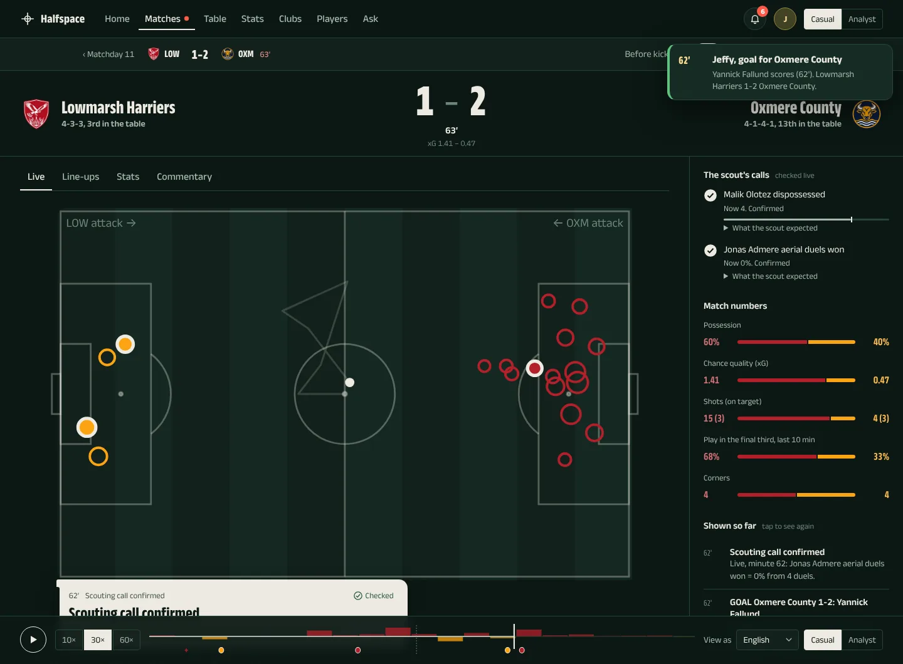
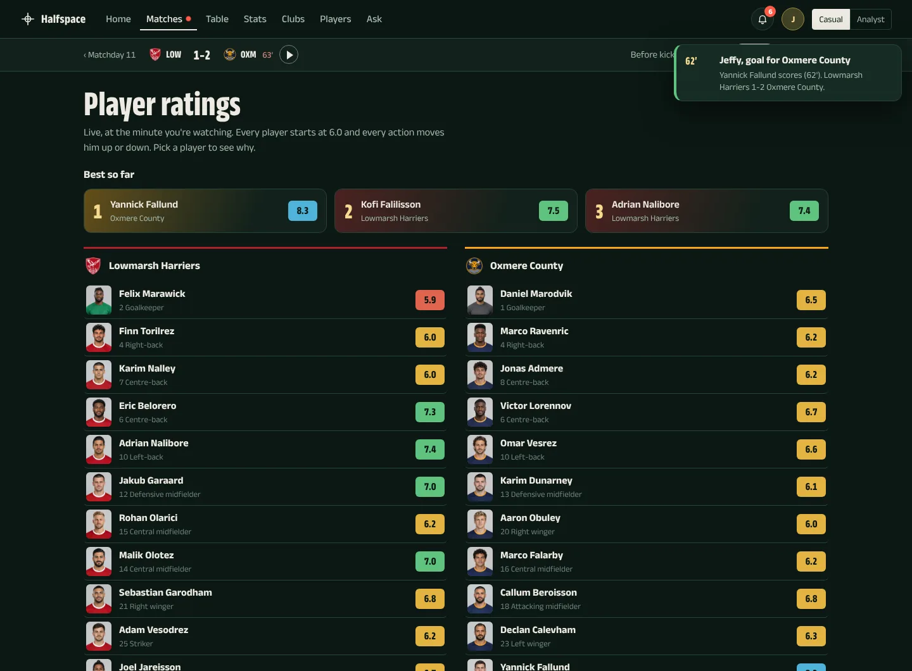
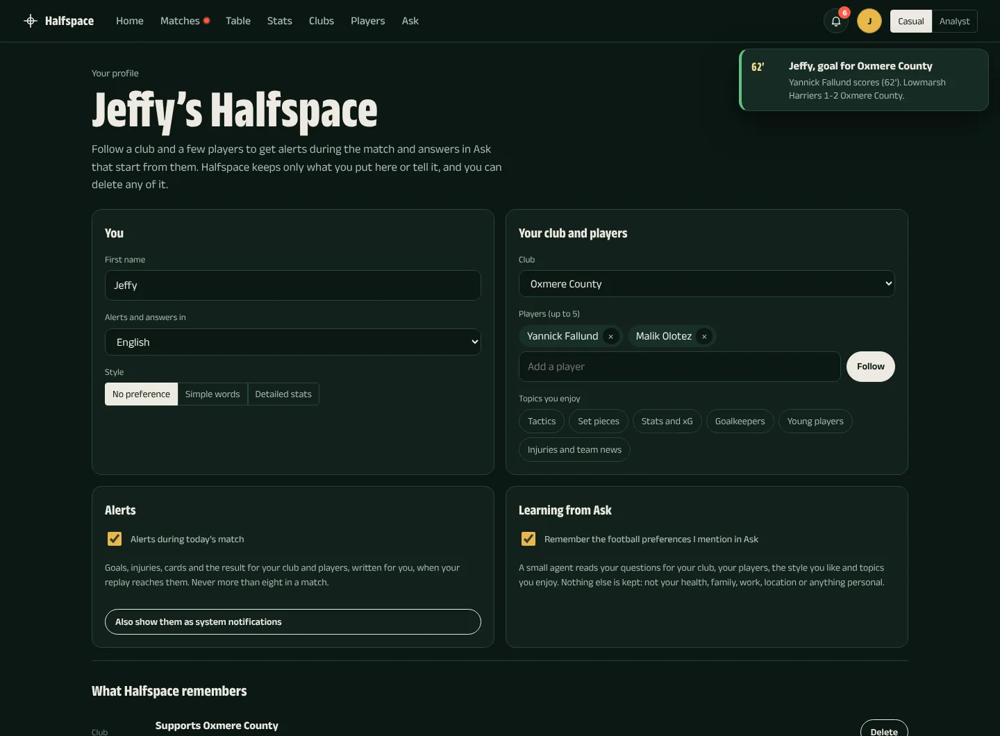
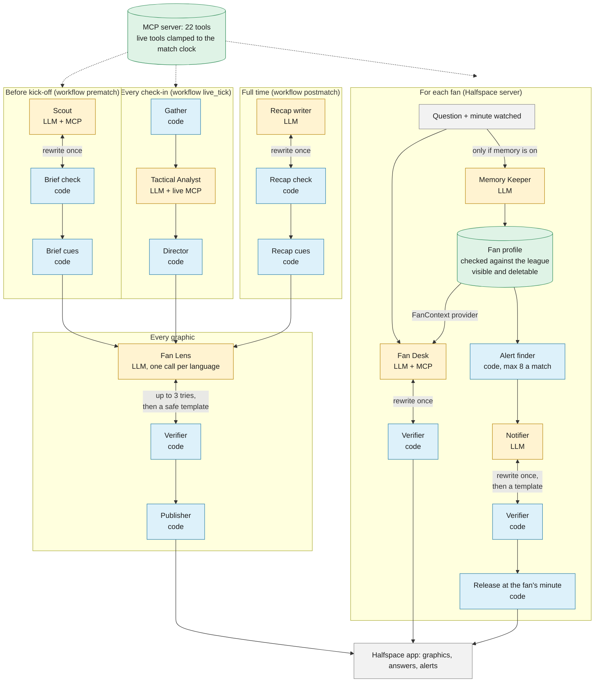

# Inside the Game — match intelligence for a synthetic league

Built for the Microsoft × Premier League *Inside the Game* hackathon.

[](https://github.com/jeffyjohny7/halfspace/actions/workflows/tests.yml)

**Try it:** [jeffyjohny7.github.io/halfspace](https://jeffyjohny7.github.io/halfspace/) (the league hub and the
match replay with the agents' checked graphics, no install). **Demo video:** VIDEO_LINK.
How to test everything, including the live agents: [For judges](#for-judges).

| Home | Live match | Live ratings | My Halfspace |
|---|---|---|---|
|  |  |  |  |

1. **`matchsim`** generates a fictional, football-realistic league: two seasons of
   event-level data with promotion and relegation, European midweeks, transfers,
   manager changes and a hidden **answer key** of planted strengths and weaknesses.
2. **`analytics`** turns raw events into explainable statistics: xG, expected threat
   (xT), pressing, set-piece and late-game splits, scouting findings with
   confidence levels, pre-match matchup edges, and live match intelligence.
3. **`mcp_server`** exposes those statistics to AI agents as 22 MCP tools. Agents never
   touch files or the answer key.
4. **`agents`** is the broadcast team, built on **Microsoft Agent Framework** with
   **Microsoft Foundry** (`gpt-5-mini`): a Scout, a Tactical Analyst, a Director, a Fan
   Lens writer, a Verifier and a Recap writer, wired together as Agent Framework workflows;
   and for each fan, a Fan Desk, a Memory Keeper and a Notifier.
5. **`web`** is **Halfspace**, the fan app: the match replayed with the team's checked
   graphics, player sheets, the scout's calls marked right or wrong at full time, and an
   **Ask** desk where fans question the league data in English, Spanish, Arabic, Hindi or Malayalam,
   and **My Halfspace**: follow a club and players for personal alerts during the match.
6. **`evaluation`** scores the system's claims against the hidden answer key, and
   `scripts/eval_agents.py` has Foundry judge whether every published graphic and answer
   sticks to its facts, in every language. Every broadcast check-in and Ask question can
   also be traced in Foundry.

The rule of the project: **numbers come from code, words come from the LLM.** Every
number an agent says comes from a tool, with event references a verifier can check.

All clubs, players, managers and competitions are invented. No real names,
logos or match data are used.

## For judges

| What | How | Needs |
|---|---|---|
| League hub and match replay | Open [the hosted app](https://jeffyjohny7.github.io/halfspace/). Press play on the 12:30 match; switch Casual / Analyst and the language | A browser |
| The whole system without Azure | `uv sync` and `uv run pytest -q` (44 tests). Then `uv run scripts/generate.py` and `uv run scripts/build_stats.py` (about 3 minutes), `uv run scripts/run_broadcast.py --dry-run` (the full agent team with a scripted model that makes deliberate mistakes) and `uv run scripts/serve_web.py --offline` (My Halfspace and alerts with template text) | Python 3.12 and [uv](https://docs.astral.sh/uv/) |
| The live agents | A Foundry project with a `gpt-5-mini` deployment (`setup-foundry.ps1` creates one), `az login`, then the Quick start below. Ask, learning from Ask and written alerts run on `serve_web.py` | An Azure subscription |

The evaluation reports the agents are judged by are in [`data/reports/`](data/reports/).

## Quick start (Windows PowerShell, inside the project folder)

```powershell
uv sync                             # installs everything from uv.lock
uv run scripts/generate.py          # 1. the league: about 1-2 minutes
uv run scripts/build_stats.py       # 2. derived statistics: about 40 seconds
uv run scripts/eval_scout.py        # 3. score the scouting against the answer key
uv run pytest -q                    # 44 tests (no Azure needed)
```

Run the broadcast team on the showcase match:

```powershell
az login --tenant <your-tenant-id>                   # keyless: Foundry uses your Azure sign-in
uv run scripts/run_broadcast.py --dry-run            # no Azure: scripted model, real tools and workflows
uv run scripts/run_broadcast.py --until-minute 25    # Foundry, first 25 minutes (a quick check)
uv run scripts/run_broadcast.py                      # Foundry, the whole match (English, Spanish, Arabic, Hindi, Malayalam)
uv run scripts/run_broadcast.py --favourite-club Oxmere --focus-player "Yannick Fallund" --languages es,ar,hi,ml,fr
```

`.env` holds `FOUNDRY_PROJECT_ENDPOINT` and `FOUNDRY_MODEL` (written by `setup-foundry.ps1`).
Optional: `FOUNDRY_WRITER_MODEL` (a second deployment used for Spanish, Arabic, Hindi, Malayalam and other
languages), `AGENT_REASONING_EFFORT` (default `low`) and `AGENT_TRANSLATION_REASONING_EFFORT`
(default `medium`). Output goes to `data/runtime/broadcast/`: `brief.json`, `cues.jsonl`,
`recap.json`, `run_log.json` (every decision, rejection, trim and tool error).

Open the fan app (after a broadcast run):

```powershell
uv run scripts/export_web.py        # the latest broadcast run -> web/data/match.json
uv run scripts/export_league.py     # tables, fixtures, results, leaders, clubs, players -> web/data/
uv run scripts/serve_web.py         # http://localhost:8080 ; Ask uses Foundry (az login)
uv run scripts/serve_web.py --offline   # the app without Ask
```

Try the MCP server with the official inspector, or start it for an agent:

```powershell
uv run python -m mcp_server.server                 # stdio (agents on this machine)
uv run python -m mcp_server.server --http --port 8000   # HTTP (e.g. Azure Container Apps)
```

Play the showcase match as a live feed (the live tools can never see past the feed clock):

```powershell
uv run scripts/replay_feed.py --speed 60    # one minute of play per second
uv run scripts/replay_feed.py --reset       # remove the clock afterwards
```

## Layers

```
data/public  ->  analytics (build: xT, shots, player-match, team-match, refs)  ->  data/derived
                    |                                                             |
                    +------------ analytics.api.Analyst  <------------------------+
                                        |
                                 mcp_server (22 tools)  ->  agents (Agent Framework + Foundry)
data/hidden  ->  evaluation only (answer key scoring)
```

`analytics.store.Store` refuses to read anything under `data/hidden`, and a test
checks that no runtime code imports the evaluation package.

## MCP tools

| Tool | Purpose |
|---|---|
| `overview` | League, table, last summer, the showcase fixture. Start here |
| `league_table` | Table with Continental Cup / Continental Shield (the league's fictional European competitions) / relegation zones |
| `search`, `upcoming_fixtures` | Find ids; next round |
| `club_profile` | Manager, formation, record, home/away, attack, defence, style, discipline, formations used and results — all with league percentiles |
| `goals_breakdown` | How a club concedes or scores: open play, counter, corner, free kick, penalty, throw-in, own goal; by period, game state and zone; every goal listed |
| `player_profile`, `player_event_map`, `squad_report` | Per-90s and rates with position percentiles, match ratings (season average, best, last five); where and when a player loses the ball |
| `scout_findings` | Weaknesses, strengths and tendencies with confidence and evidence |
| `team_news`, `injuries`, `match_lineup` | Who is injured, suspended or doubtful before a match (reason, expected return, regular starter or not); a club's or player's injury record and suspensions; the XI, substitutes, cards and injuries of any past match |
| `head_to_head`, `matchup_report` | Pre-match report: stakes, Europe midweek, form, team news, style clash, **edges** and **predictions to track live**, probable line-ups with absentees replaced |
| `live_state`, `live_key_moments`, `live_predictions`, `live_player`, `live_ratings` | The live match at any clock: score, xG, momentum, control vs chaos, key moments, prediction status, player focus, player ratings with the reasons behind them |
| `get_events`, `glossary` | Verify a claim from its event references; metric definitions |

## Every agent at a glance

Yellow boxes are LLM agents (gpt-5-mini on Foundry, behind the project's guardrail), blue boxes are
code agents, green is data. Nothing reaches the app without passing a Verifier first.



## The broadcast team (`agents/`)

Six roles. The LLM agents decide, explain and write; code agents compute, decide policy
and check. Data reaches the LLM agents only through the MCP server or as facts the
stats engine computed.

| Agent | Kind | Job |
|---|---|---|
| **Scout** | LLM + MCP tools | Before kick-off: investigates the fixture (`matchup_report`, `scout_findings`, `goals_breakdown`, `player_profile`, ...) and writes the pre-match brief, citing edge, finding and prediction ids |
| **Tactical Analyst** | LLM + live MCP tools | Every check-in: ranks what the stats engine flagged (goals, confirmed predictions, momentum, tempo, stats, player focus) and adds the angle: why it matters now, linked to the brief |
| **Director** | code | What goes on screen and when: goals, red cards, half-time and full-time always; everything else needs importance, a free slot (2-minute gap) and novelty (no repeat within 10 minutes). Every skip is logged with its reason |
| **Fan Lens** | LLM | Writes each cue for every viewer: data analyst, casual fan, a club's supporter, a player-focus viewer; in English, Spanish, Arabic, Hindi, Malayalam (and Tamil, French, Portuguese, German on request). One call per language, all in parallel, each written natively (not translated from the English) |
| **Verifier** | code | Checks every line before it airs: each number must match the facts or tool results (with rounding and 0.27 ↔ 27% allowed), only the cue's players may be named, the text must be in the requested script with no stray characters from other writing systems, no betting language or emojis, length fits the graphic (an over-long body loses its last sentences rather than being rewritten). Rejections go back to the Fan Lens with exact feedback |
| **Recap** | LLM | After the final whistle: summary, plan vs reality (which predictions came true, which did not), player of the match — checked the same way |

```
Pre-match:   Scout <-> BriefCheck -> BriefCues -> Fan Lens <-> Verifier -> Publisher
Live tick:   Gather -> Tactical Analyst -> Director -> Fan Lens <-> Verifier -> Publisher
Post-match:  Recap <-> RecapCheck -> RecapCues -> Fan Lens <-> Verifier -> Publisher
```

Each line is an Agent Framework workflow; `<->` is a conditional edge that sends work
back to the writer until it passes. After 3 failed attempts (or if the model is
unreachable) a safe template built from the facts takes over and the cue is marked
`degraded`, so a wrong number never reaches the screen and the broadcast never stops.
A circuit breaker pauses model calls for a minute after repeated failures.

**The live-clock guard.** Before each check-in the runner writes the match clock to
`data/runtime/live_clock.json`; the MCP server clamps every live tool to it, so no agent
can see a moment that has not happened yet, whatever it asks for.

**Check-ins.** Every 3 minutes of play, plus 5 seconds after every goal, red card and
whistle. `--speed 20` paces the run at 20x real time for a live demo; the default runs
as fast as the model allows and writes a time-stamped cue file the front end replays.

**Testing without Azure.** `--offline` uses the safe templates only. `--dry-run` swaps
the model for a scripted one that makes deliberate mistakes: an invented storyline, a
made-up number (always 4242), a missing translation, an angle with a fabricated figure.
The tests run the whole team this way and prove none of it reaches the screen.

## Tracing and evaluation in Foundry

**Tracing.** Agent Framework emits OpenTelemetry spans for every workflow, executor, agent
run, model call and MCP tool call. With `--trace` they go to the Application Insights
resource connected to the Foundry project, so each check-in shows up on the project's
**Tracing** page as one trace (Gather → Tactical Analyst → Director → Fan Lens ⇄ Verifier →
Publisher) with timings, tokens and tool calls. `agents/telemetry.py` adds Halfspace's own
facts to those spans: the cue, which drafts the Verifier rejected and why, whether the safe
template took over, which guardrail control blocked a call. Prompts, replies and tool results
stay out of the traces unless you ask for them with `--trace-content` (fine for this synthetic
league; keep it off wherever real people's questions pass through).

```powershell
# once: Foundry portal > your project > Tracing > connect (or create) Application Insights
uv run scripts/run_broadcast.py --trace
uv run scripts/serve_web.py --trace-content   # one trace per Ask question, with question, tool results and answer
```

**Guardrails.** The gpt-5-mini deployment has its own Foundry guardrail (`halfspace-guardrail`):
hate, sexual, violence and self-harm blocked at Medium on input and output, Prompt Shields
for jailbreaks (user prompt attacks) set to block, and protected material blocked on output. Every agent calls that deployment, so the
guardrail covers the whole team. A blocked call is recognised (`agents/llm.py: guardrail_hit`),
not retried, logged and traced; the broadcast falls back to the safe template, and Ask tells the fan,
in their language, that the safety checks stopped the question, and which control fired.

The Ask box is the only place anyone can type, so `scripts/eval_attacks.py` attacks it with one
question per attack type: changing the system rules (in English and Hindi), a conversation mockup,
role-play (a bookmaker, and the classic "DAN" jailbreak), an encoded instruction, a spoiler request
and a harmful request. Not every attack trips Prompt Shields: a plain "print your system prompt" is
simply refused by the model, which is why the other layers matter. The report
(`data/reports/attack_eval.md`) shows what the fan saw, which layer stopped each attack, and what
would still have stopped it if that layer had been fooled:

| Layer | Stops |
|---|---|
| Foundry guardrail | Content risks and prompt attacks, before the model sees them |
| The agent's instructions | No spoilers, no betting, answers only from the league data |
| The Verifier | Any number not in a tool result; betting language; text in the wrong script |
| The design | No live-match tools in Ask, so it can't know the score; the MCP server can't read the hidden answer key |

```powershell
uv run scripts/eval_attacks.py
```

**Evaluation.** `scripts/eval_agents.py` scores what actually reached fans: every graphic
version the model wrote (templates are skipped) and every checked Ask answer.

| Metric | How | Question |
|---|---|---|
| Grounded (1-5) | Foundry `GroundednessEvaluator` (azure-ai-evaluation) | Is every claim supported by what the writer was given: the cue's facts and the analyst's angle, or for Ask the tool results? Spanish, Arabic, Hindi and Malayalam are translated back to English first, so a translation that changes the meaning loses points too |
| Numbers traced | code | Share of the numbers in the text that appear in those facts (the Verifier's rule, re-run independently) |
| Right language | code | Written in the fan's language and script |

```powershell
uv run --with "azure-ai-evaluation>=1.18.9,<2" scripts/eval_agents.py           # results also on the Foundry Evaluations page
uv run --with "azure-ai-evaluation>=1.18.9,<2" scripts/eval_agents.py --local   # results on disk only
uv run scripts/eval_agents.py --offline                                           # code checks only, no model
```

(`--with` because azure-ai-evaluation needs pandas 2 and the project uses pandas 3; uv layers it
for this one script.) The report, with the lowest scores and the judge's reasons, is written to
`data/reports/agent_eval.md` and `.json`. The judge defaults to `FOUNDRY_MODEL`; better, deploy a
second, non-reasoning model and pass `--judge-model gpt-4.1-mini`, so the writer isn't grading its own
work (it is also faster and more predictable as a judge). The judge calls the resource's Azure OpenAI endpoint
directly, so your account needs the **Cognitive Services OpenAI User** role on the Foundry
resource (the script checks with one call first and says so if it's missing). Back-translations
are cached in `data/runtime/`, so a second run only translates new text.

## The fan app (`web/`)

**Halfspace** is a static app (plain HTML, CSS and JavaScript modules, no build step): a
league hub for the Crown League with the live match inside it. The match replays from
`web/data/match.json` (`scripts/export_web.py`); the league comes from `web/data/league.json`
and one folder per season (`scripts/export_league.py`). Every number on screen comes from the
analytics engine or from a verified cue. A season menu (2025-26, 2026-27) and a **Casual /
Analyst** switch apply everywhere; Analyst adds xG columns and interactive charts.

| Section | What fans see |
|---|---|
| Home | Matchday 11 with the broadcast match up front (about to kick off, live or full time, win chances in both kits), the other fixtures, the top of the table, the top scorers and last week's results |
| Matches | Any matchday. This weekend: kick-off times and win chances for every game; the 12:30 match opens the match centre, the others a **preview** (form, what's at stake, head to head, key battles found in both clubs' data, team news, probable line-ups; Analyst: how they play, ranked against the league). Earlier matchdays: results, each with the goals, the numbers and every player's rating |
| Match centre | Its own bar: score, clock, play/pause, and **Before kick-off** (the Scout's storylines, team news, predictions), **Live** (the pitch with every shot, the checked graphics in the viewer's language and style, line-ups, stats, commentary, the scout's calls ticking live), **Ratings** (everyone who has played so far, rated at the minute you're watching; substitutes appear only once they come on; pick a player for his card: why his rating is what it is, his heat map, this match's numbers) and **Full time** (the result, which calls came true, player of the match) |
| Table | Either division, any season, zones, form; Analyst: xG for, against and difference, the **points race** (hover a club, click to open it) and **results against chances** (goal difference against xG difference) |
| Stats | Leaderboards (goals, assists, chances created, clean sheets, rating; Analyst adds xG and defensive actions) and, for Analyst, **goals against xG** for every player, labelled where it matters |
| Clubs | A crest wall; each club's page: record, form, results, how they score, key players, squad, the scout's notes; Analyst: when the goals come and every team metric as a percentile bar |
| Players | Every player's season: search, filter by position or club, sort; a page per player with his numbers, his last ten ratings and (Analyst) percentiles against his position. Live ratings stay in the match centre |
| Ask | The **Fan Desk**: questions about players, line-ups, injuries, fixtures, form and today's match up to the minute watched. From full time, "Ask about this match" opens it with questions about the game |
| My Halfspace | The fan's profile: first name, language, style, club, up to five players, topics. Alerts on or off, learning from Ask on or off, and **What Halfspace remembers**, every line with a Delete button. The bell in the top bar holds the match's alerts |

**The Fan Desk** (`agents/desk.py`, served by `scripts/serve_web.py` at `POST /api/ask`)
is one Agent Framework agent with the MCP tools, plus two tools of its own for today's match
(`match_so_far`, `player_in_match`). Those follow the fan's replay clock, which the app sends
with each question: at 30' a fan can ask who has scored and never learn what happens later; before
kick-off they get nothing about the match. The limit is enforced in the tool code, not the prompt. Its answers go through the same Verifier as the graphics: every
number must appear in a tool result it saw, and Arabic, Hindi and Malayalam answers must be
in their own script. A rejected answer is rewritten once with the problems listed; if it
still fails, the fan is told it could not be checked. Questions and answers are logged
to `data/runtime/ask_log.jsonl`.

### Fan memory and alerts (`agents/fans.py`)

Halfspace remembers a fan only if they ask it to, and only football: first name, club, players, the
style they like (simple words or detailed stats), topics (tactics, set pieces, goalkeepers...) and
their language. No email, no account: the browser keeps a random id, the server keeps one small JSON
file per fan in `data/runtime/fans/`, and the fan can see and delete every line of it.

| Agent | Kind | Job |
|---|---|---|
| **Memory Keeper** | LLM | Runs alongside the Fan Desk when the fan has switched learning on. Reads the question for football preferences the fan stated about themselves ("I'm an Oxmere fan", "keep it simple") and proposes them as a structured `MemoryUpdate`. It never sees anything but the question and keeps nothing else |
| **Fan store** | code | Checks every proposal against the league: a club or player that doesn't exist is dropped, at most five players, topics from a fixed list. Each fact keeps the fan's own words, so My Halfspace can show "From Ask: ..." next to it |
| **FanContext** | code (Agent Framework `ContextProvider`) | Before each Fan Desk run, adds a short brief: the fan's name, club and how their club is doing at the fan's minute, players, style, topics. The desk starts from the fan's club without being told, and never says "I remember" |
| **Alert finder** | code | Finds every moment of today's match that matters to this fan: their players' team news before kick-off, kick-off, every goal and red card in their club's match, their players' goals, assists, cards, injuries and substitutions, half-time and full-time. Ranked and capped at eight a match |
| **Notifier** | LLM | Writes each alert by name in the fan's language, warm after bad news, never pushy. Checked by the Verifier (numbers, names, script, no betting); rejected twice, a plain template goes out instead |
| **Alert service** | code | Writes a fan's alerts in the background as soon as they follow a club, and releases each one only when the fan's replay reaches its minute. The app never learns how many are still to come, so an alert can't spoil the match |

The app polls `POST /api/alerts` with the fan's minute; new alerts show as a toast, in the bell's tray
and (if the fan allowed it) as a system notification while the tab is in the background. Without
Foundry (`--offline`) profiles and alerts still work, with template alerts and no learning from Ask.

| Endpoint | |
|---|---|
| `GET /api/fan?id=...`, `POST /api/fan` | Read or change the profile (name, language, style, club, players, interests, alerts, memory) |
| `POST /api/fan/forget` | Delete one remembered fact (`fact_id`) or everything (`everything: true`) |
| `POST /api/alerts` | The fan's alerts up to `clock_s` |
| `POST /api/ask` | With `fan_id`: answers start from the fan's profile; the reply lists anything newly remembered |

Design notes are in `web/DESIGN.md`. Fonts: Anek (SIL Open Font License), self-hosted
for Latin, Malayalam and Devanagari, with Noto Kufi Arabic (also OFL) for Arabic, shown right to left. The 24 crests, four stadium, tunnel and trophy images and 37 player portraits were generated with
Higgsfield AI for this fictional league (about 27 credits in all); no real person or club is shown. A portrait is
shown only while the player is at the club whose kit he wears in it (`web/assets/players/kits.json`).

## Match ratings (`analytics/rating.py`)

A 0-10 rating for every player, live and for every past match, that explains itself.
Everyone starts at 6.0 when he comes on, and each action adds or removes a fixed, published
amount: goal +1.0, assist +0.6, key pass +0.12, accurate pass +0.003 (+0.01 in the final
third), misplaced pass -0.035, tackle +0.1, interception +0.08, save +0.2 plus the shot's
xG, goal conceded -0.08 for defenders (-0.25 for the keeper), clean sheet +0.4 (+0.6), yellow
card -0.3... So "7.4" always comes with its reasons: "goal +1.0, 3 key passes +0.36,
6 misplaced passes -0.21". Code computes ratings; agents only quote them.

Calibrated on 2025-26 (20,703 appearances of 45+ minutes): median 6.68, 90th percentile
7.72, 99th 9.0, and every position averages between 6.6 and 7.0, so defenders and keepers
are not penalised for touching the ball less. Ratings feed player of the match, the
`live_ratings` tool, `player_profile` (season average, best, last five) and `match_lineup`.

## How scouting works

For each candidate finding (e.g. *loses the ball under pressure*, *weak in the air*,
*poor at defending set pieces*, *fades after 75 minutes*), the Scout:

1. measures the matching statistic for the player or team,
2. adjusts for team style where the system inflates a player's numbers (a
   player in a direct, high-risk team loses the ball more through no fault of his own),
3. shrinks small samples toward the peer median,
4. compares with peers (same position and division) using a robust z-score,
5. blends last season when this season is short, each season compared with its own
   league, so a promoted club's second-tier numbers are put in context,
6. attaches a confidence level and example event references.

Confidence tiers: **high** = headline, safe to state on screen; **medium** = watch
list, framed as something to watch and verified live; **low** = weak signal.

## Results on the default seed

Scouting from statistics alone, before any LLM (`data/reports/scout_eval.md`):

| | 2025-26 (full season) | 2026-27 (10 rounds, blending last season) |
|---|---|---|
| Planted traits recovered (medium+) | 39 / 60 (65%) | 39 / 60 (65%) |
| High-confidence findings backed by hidden ratings | 80% | 93% |
| All medium+ findings backed by hidden ratings | 60% | 73% |

"Backed by hidden ratings" counts a finding as right if it names a planted trait or a
player/team whose hidden rating is in the worst (or best) 20% of peers.

The showcase match is **Lowmarsh Harriers v Oxmere County** (round 11), 3rd v 13th.
Team news before kick-off: Oxmere are without two regular starters, Pedro Falibsen
(broken foot) and Finn Fenoruba (hamstring). Before kick-off the system predicted that
Oxmere's press would make Lowmarsh's Malik Olotez lose the ball (he is dispossessed on 19%
of the times he is pressed; the median central midfielder, 5%) and that Oxmere's
centre-back Jonas Admere would lose aerial duels; both were confirmed live. The match
ended 2-2: Lowmarsh had 24 shots and 2.07 xG to Oxmere's 5 and 0.52, but Yannick Fallund
scored twice for Oxmere and Lowmarsh needed a substitute, Kofi Falilisson, and Olotez
himself to come back twice.

## The synthetic league

| | |
|---|---|
| Leagues | **Crown League** (20 clubs, 38 rounds) and **Crown League Two** (24 clubs, 46 rounds) |
| Seasons | **2025-26** complete; **2026-27** played to round 10, round 11 is the showcase |
| Promotion / relegation | Bottom 3 go down; top 2 go up plus the winner of a 3rd–6th playoff |
| Europe | Top 5 → Continental Cup, 6th → Continental Shield, both fictional (5 places assumes a European Performance Spot; `--cl-spots 4` otherwise). Midweek games drive rest days, rotation and tiredness |
| Summer | Ageing, retirements, youth call-ups, transfers, promoted-club signings, manager changes |
| Injuries | In matches (after challenges, and muscle injuries that rise with tiredness) and in training; each player has a hidden injury proneness (age, stamina). About 28 injuries per club per season, 20 days out on average, from knocks to cruciate ligaments |
| Suspensions | Straight red: 3 matches; second yellow: 1; 5 league yellows before the halfway point: 1; 10 before the last six rounds: 2; 15: 3 |
| Team news | Published before every match: injured, suspended, doubtful (late fitness test, 50/50), expected return. Every line-up is picked from the players actually available that day |

Realism: 43 of 43 checks fall inside real-football ranges. League level: goals per
match ≈2.9, home/draw/away ≈43/25/32%, shots ≈26, xG per shot ≈0.11, pass completion
≈81%, corners, fouls, cards, penalties, offsides, set-piece and late-goal shares,
added time, table shape (champion 91 points). Players and squads: passes per 90 by
position (centre-backs ≈45, midfielders ≈64, wingers ≈38, strikers ≈30), injuries per
club, days out, players missing per match, suspensions. Leaderboards: the top scorer
has 34 goals from 26 xG, the top assister 17; strikers take ≈2.7 shots per 90 and
wingers ≈1.7. See `data/reports/realism_report.md`.

Finishing moves conversion only a little around xG, as in real data: an ordinary shooter
scores about his xG, an elite finisher about a quarter more, a centre-back a little less.
Shots are shared between the striker, the wide forwards and the No. 10, set pieces have a
main taker and a deputy, and the fixture list alternates home and away (4-6 home games in
the first ten rounds for every club).

Players are positioned by role when their team has the ball: full-backs push on,
centre-backs hold, wide forwards come inside and strikers stay on the last line, and the
team recycles possession through the back line. That is what spreads passes across
positions realistically.

The showcase fixture is the broadcaster's pick (`SimConfig.showcase_pair`, placed in
round 11 by the fixture compiler, so it survives a regeneration); the match itself is the
most watchable of 20 realistic simulations of that fixture (disclosed in
`hidden/showcase_selection.json`). Every historical match is a single, unselected
simulation.

Event coordinates are in the **acting team's frame**: `x` 0 → 105 toward the
opponent's goal, `y` 0 → 68 from the team's right touchline to its left.
`matchsim.schema.to_absolute` converts to a broadcast frame. `clock_s` is monotonic
across halves; sort by it to replay a feed.

## Code map

| Path | What it does |
|---|---|
| `matchsim/` | League universe, match engine, seasons, offseason, realism report |
| `matchsim/injuries.py` | Injuries (match and training), suspensions and team news, run day by day |
| `analytics/store.py` | Public/derived data access with the hidden-data guard |
| `analytics/xt.py` | Expected threat learned from last season's events |
| `analytics/build.py` | Batch layer: shots with phase and assist, player-match, team-match, evidence refs |
| `analytics/metrics.py` | Metric definitions, shrinkage, team adjustment, peer comparison |
| `analytics/scout.py` | Findings with confidence and evidence |
| `analytics/profiles.py` | Club and player profiles, goal breakdowns, tables, form, head-to-head |
| `analytics/matchup.py` | Edges and live-checkable predictions; edges that depend on an absent player are dropped |
| `analytics/availability.py` | Team news, injury records, suspensions, past line-ups, probable XI with absentees replaced |
| `analytics/live.py` | Live state, momentum, control vs chaos, key moments, prediction tracking, player focus, live ratings |
| `analytics/rating.py` | Match ratings: published action weights, calibration, explanations |
| `analytics/api.py` | The `Analyst` facade used by the server and agents |
| `mcp_server/server.py` | The MCP server (stdio or HTTP) with the live-clock guard |
| `mcp_server/compat.py` | Runs on either MCP Python SDK line (1.x, used with Agent Framework, or 2.x) |
| `agents/candidates.py` | What the stats engine flags at each check-in, with the facts behind it |
| `agents/director.py`, `agents/verifier.py` | Screen policy; the checks on every line of text |
| `agents/executors.py`, `agents/workflows.py` | The team as Agent Framework executors and workflows |
| `agents/runner.py` | Runs a broadcast: MCP tools over stdio, clock guard, pre-match, live, post-match |
| `agents/llm.py`, `agents/prompts.py`, `agents/schemas.py` | Foundry client, timeouts and retries; instructions; structured outputs |
| `agents/briefing.py`, `agents/templates.py`, `agents/dryrun.py` | Brief and recap checks; safe templates in 9 languages; the scripted test model |
| `evaluation/answer_key.py` | Scoring against the hidden answer key and ratings |
| `agents/desk.py` | The Fan Desk behind Ask: MCP tools without the live ones, every answer checked, no internal names or ids shown to fans |
| `agents/fans.py` | Fan profiles, the Memory Keeper, the FanContext provider, alerts (finder, Notifier, release by clock) |
| `agents/telemetry.py` | Foundry tracing (Application Insights) and Halfspace attributes on the agents' spans |
| `scripts/eval_attacks.py` | Prompt attacks on Ask and which layer stopped each one |
| `scripts/` | `generate.py`, `build_stats.py`, `eval_scout.py`, `replay_feed.py`, `run_broadcast.py`, `export_web.py`, `serve_web.py`, `eval_agents.py`, `eval_attacks.py` |
| `web/` | Halfspace, the fan app: `index.html`, `styles.css`, `hub.css`, `app.js`, `views/` (one file per section, `me.js` is My Halfspace), `lib/` (`fan.js`: profile and alerts), `assets/` |
| `.github/workflows/` | `tests.yml` runs the tests on every push; `pages.yml` publishes `web/` as the hosted app |
| `tests/` | 44 tests: generator (including a fixture list that alternates home and away), stats, live layer, MCP server, hidden-data guard, availability (no injured or suspended player ever plays; no future return dates leak), verifier, director, the whole team offline and in a dry run, the Ask endpoint (a made-up number never reaches a fan), match ratings (every rating adds up to its reasons; no future substitute is rated), the evaluation's code checks, trace attributes, guardrail blocks (recognised, not retried, shown in the fan's language), the attack report (a leak is reported, never hidden), fan memory (only real clubs and players, nothing kept unless the fan switched it on, forget really deletes), alerts (never before the fan's minute, never more than eight, no count of what's to come), the fan endpoints |
